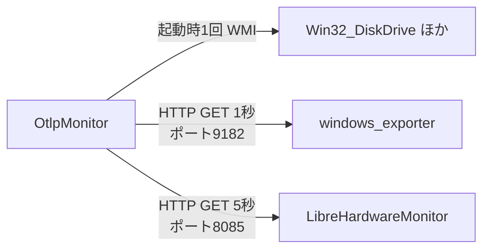
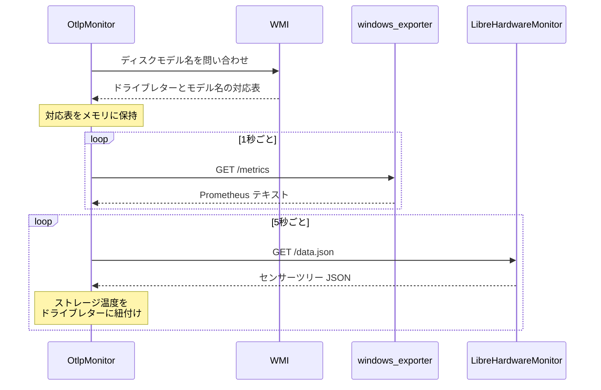

# OtlpMonitor

Windows 11 常駐型のシステムモニター（WPF / .NET 10）。CPU・メモリ・GPU・ディスク・ネットワーク・温度をデスクトップ上に常時表示する。

> **注記**: 本ドキュメントは Grafana Alloy 依存を廃した Pull 型構成を前提とする。改修の詳細は [`report/simple.md`](report/simple.md) を参照。旧構成の OTLP 受信サーバー（`127.0.0.1:14318`）は廃止済み。

## 目次

1. [概要](#概要)
2. [アーキテクチャ](#アーキテクチャ)
3. [動作要件](#動作要件)
4. [セットアップ](#セットアップ)
   - [windows_exporter](#windows_exporter)
   - [LibreHardwareMonitor](#librehardwaremonitor)
   - [OtlpMonitor](#otlpmonitor-1)
5. [動作確認](#動作確認)
6. [ポーリング周期のチューニング](#ポーリング周期のチューニング)
7. [セキュリティと運用上の注意](#セキュリティと運用上の注意)
8. [トラブルシューティング](#トラブルシューティング)

## 概要

依存するのはローカルで動く 2 つのソフトウェアだけ。

| ソフトウェア | エンドポイント | 取得するもの | 既定周期 |
|---|---|---|---|
| windows_exporter | `http://127.0.0.1:9182/metrics` | CPU・メモリ・GPU・ディスク I/O・ネットワーク・プロセス Top5・CPU 温度 | 1 秒 |
| LibreHardwareMonitor | `http://127.0.0.1:8085/data.json` | DIMM 温度・ストレージ温度 | 5 秒 |

加えて起動時に 1 回だけ WMI を呼び、ドライブレターとディスクモデル名の対応表を作る。LHM が返すストレージ温度はハードウェア名がディスクのモデル名なので、これを `C:` のようなドライブレターに紐付けるために必要。

CPU 温度は LHM ではなく windows_exporter の `windows_thermalzone_temperature_celsius` から取る。ファン回転数とクロック周波数は取得しない。

## アーキテクチャ





## 動作要件

| 項目 | 要件 |
|---|---|
| OS | Windows 10 / 11（21H2 以降）または Windows Server 2016 以降。Server 2012 R2 以前は windows_exporter 側に既知の互換性問題あり |
| .NET | `net10.0-windows`。framework-dependent で発行した場合は .NET 10 デスクトップランタイムが必要。self-contained 発行なら不要 |
| 権限 | OtlpMonitor 本体は標準ユーザーで動く。LibreHardwareMonitor は**管理者権限が必須**。windows_exporter は Windows サービスとして SYSTEM 権限で動作 |

## セットアップ

### windows_exporter

配布元は GitHub の [prometheus-community/windows_exporter](https://github.com/prometheus-community/windows_exporter)。MSI は [Releases](https://github.com/prometheus-community/windows_exporter/releases) から入手する。バイナリと MSI は自己署名証明書で署名されており、警告を避けるならリポジトリの `installer/codesign.cer` を信頼されたルート証明書ストアにインポートする。

このアプリが必要とするコレクタのうち **`process` / `gpu` / `thermalzone` は既定で無効**。明示的に有効化しないとプロセス一覧・GPU 使用率・CPU 温度が表示されない。

あわせて `LISTEN_ADDR=127.0.0.1` でループバックに限定し、`ADDLOCAL=FirewallException` を**付けない**ことでファイアウォール例外を作らせない。

**winget**

```powershell
winget install --id Prometheus.WindowsExporter --override "/quiet ENABLED_COLLECTORS=cpu,memory,system,logical_disk,net,process,gpu,thermalzone LISTEN_ADDR=127.0.0.1"
```

**MSI 直接実行**（管理者権限の PowerShell）

```powershell
msiexec /i "C:\path\to\windows_exporter-x.y.z-amd64.msi" /qn --% ENABLED_COLLECTORS=cpu,memory,system,logical_disk,net,process,gpu,thermalzone LISTEN_ADDR=127.0.0.1
```

`--%` 以降は PowerShell が解釈せずそのまま `msiexec` に渡る。`EXTRA_FLAGS` に引用符を含む値を渡す場合のみ、事前に `$PSNativeCommandArgumentPassing = 'Legacy'` が要る（PowerShell 7.3 以降）。

設定を後から変えるなら、インストール先（既定 `C:\Program Files\windows_exporter`）の YAML 設定ファイルを編集してサービスを再起動する。ただし **MSI プロパティで指定した値は常に設定ファイルより優先される**ので、両方で同じ項目を指定しないこと。

### LibreHardwareMonitor

1. LibreHardwareMonitor を**管理者権限で**起動する。WinRing0 系のカーネルドライバをロードしてハードウェアセンサーを読むため、標準ユーザーでは温度が取れない
2. `Options` → `Remote Web Server` → `Port` が `8085` であることを確認し、`Run` にチェックを入れる

**ファイアウォールで塞ぐ**（管理者権限の PowerShell）

LHM の Web サーバーがバインドアドレスを `127.0.0.1` に制限できるかは**未確認**。全インターフェースで待ち受ける可能性があるため、インバウンドをブロックしておく。

```powershell
New-NetFirewallRule -DisplayName "Block LibreHardwareMonitor Web Server" -Direction Inbound -Action Block -Protocol TCP -LocalPort 8085
```

実際の待ち受けアドレスは `netstat -ano | Select-String ":8085"` で確認できる。

**ログオン時の自動起動**（管理者権限の PowerShell）

LHM が起動していないと温度表示が欠ける。管理者権限での自動起動はタスクスケジューラで登録する。

```powershell
$Action    = New-ScheduledTaskAction -Execute "C:\path\to\LibreHardwareMonitor.exe"
$Trigger   = New-ScheduledTaskTrigger -AtLogOn
$Principal = New-ScheduledTaskPrincipal -UserId "$env:USERDOMAIN\$env:USERNAME" -LogonType Interactive -RunLevel Highest
Register-ScheduledTask -TaskName "LibreHardwareMonitor" -Action $Action -Trigger $Trigger -Principal $Principal
```

### OtlpMonitor

設定はレジストリ `HKEY_CURRENT_USER\Software\DIOTLPGUI` に保存される。値が無ければ既定で動く。

| 値名 | 型 | 既定 | 内容 |
|---|---|---|---|
| `WindowsExporterIntervalMs` | DWORD | `1000` | windows_exporter のポーリング間隔（ミリ秒） |
| `LhmIntervalMs` | DWORD | `5000` | LibreHardwareMonitor のポーリング間隔（ミリ秒） |
| `FontFamilyName` | String | `Cascadia Mono` | 表示フォント |
| `FontSize` | String | `11` | フォントサイズ（8〜24 にクランプ） |
| `IsCalendarExpanded` | DWORD | `0` | カレンダーセクションの展開状態 |

周期を変えたら OtlpMonitor を再起動する。

## 動作確認

アプリを起動する前に、両エンドポイントが期待どおり応答するか確かめる。

**windows_exporter — 既定無効のコレクタが効いているか**

```powershell
$lines = (Invoke-WebRequest -Uri "http://127.0.0.1:9182/metrics" -UseBasicParsing).Content -split "`n"
$lines | Select-String "^windows_thermalzone_temperature_celsius"   # CPU 温度
$lines | Select-String "^windows_process_working_set_bytes"          # プロセス一覧
$lines | Select-String "^windows_gpu_engine_time_seconds"            # GPU
```

3 つとも 1 行以上返れば `process` / `gpu` / `thermalzone` が有効。空なら `ENABLED_COLLECTORS` の指定漏れ。

`thermalzone` だけ空の場合はマシンが ACPI サーマルゾーンを公開していない可能性がある。この場合 CPU 温度は表示されない。

**LibreHardwareMonitor — センサーツリーが取れるか**

```powershell
$json = Invoke-RestMethod -Uri "http://127.0.0.1:8085/data.json"
$json.Children.Children | Select-Object Text     # 検出されたハードウェア一覧
```

メモリとストレージが一覧に出てくれば OK。管理者権限で起動していないと、ここが空か極端に少なくなる。

## ポーリング周期のチューニング

既定値は UI の追従性とシステム負荷の釣り合いから決めている。

- **windows_exporter 1 秒**: CPU 使用率は累積カウンタの差分から出すため、Windows のタイマー割り込み粒度（約 15.625ms）による量子化誤差が乗る。1 秒間隔なら ±1 tick で約 ±1.6%、500ms では約 ±3.1% に悪化する（tick 数からの算術による推定）。タスクマネージャーの既定更新速度と同等
- **LHM 5 秒**: 温度の熱時定数は秒〜数十秒オーダーで、それより短く取っても情報量が増えない。加えて DIMM 温度は SMBus 経由、NVMe の Composite Temperature は Admin コマンド発行なので、高頻度アクセスは他デバイスとのバス競合や通常 I/O へのジッタというリスクを伴う（推定。実測での確認が望ましい）

短くする場合は負荷を実測する。

```powershell
# OtlpMonitor / windows_exporter / LHM の CPU 時間を 10 秒サンプリング
$before = Get-Process OtlpMonitor,windows_exporter,LibreHardwareMonitor -ErrorAction SilentlyContinue |
          Select-Object Name, @{n='Cpu';e={$_.TotalProcessorTime.TotalSeconds}}
Start-Sleep 10
$after  = Get-Process OtlpMonitor,windows_exporter,LibreHardwareMonitor -ErrorAction SilentlyContinue |
          Select-Object Name, @{n='Cpu';e={$_.TotalProcessorTime.TotalSeconds}}
foreach ($a in $after) {
    $b = $before | Where-Object Name -eq $a.Name
    "{0}: {1:N2}% ({2} コア換算)" -f $a.Name, (($a.Cpu - $b.Cpu) / 10 * 100), [Environment]::ProcessorCount
}
```

アイドル時の合計が 2% を超えるなら短縮しすぎ。`process` コレクタを外すか周期を戻す。常駐モニターが CPU を食って C-State 遷移を妨げるのは本末転倒。

`process` コレクタを外す場合、プロセス Top5 とハンドル数の表示は失われる。

## セキュリティと運用上の注意

どちらのエンドポイントにも認証がない。`process` コレクタを有効にすると、稼働中の全プロセス名と PID が HTTP で読める状態になる。

- windows_exporter は `LISTEN_ADDR=127.0.0.1` を必ず指定する
- `ADDLOCAL=FirewallException` を付けない。付けると 9182/tcp が LAN に開く
- LHM 側はバインド制限の可否が未確認のため、8085/tcp のインバウンドブロックルールを維持する
- リモートから見たい場合は、エンドポイントを直接公開せず SSH ポートフォワードなどを挟む

## トラブルシューティング

| 症状 | 原因 | 対処 |
|---|---|---|
| 何も表示されない | windows_exporter サービスが停止している | `Get-Service windows_exporter` で状態確認。`Start-Service windows_exporter` で起動し、スタートアップの種類を「自動」にする |
| 何も表示されない（サービスは動作中） | ポート競合で 9182 を他プロセスが使用 | `netstat -ano \| Select-String ":9182"` で PID を特定。競合するなら MSI の `LISTEN_PORT` を変えて再インストールし、アプリ側の接続先も合わせる |
| DIMM 温度・ストレージ温度が出ない | LHM が管理者権限で動いていない | タスクスケジューラの登録で「最上位の特権で実行する」が有効か確認。手動起動なら右クリック →「管理者として実行」 |
| プロセス Top5・GPU・CPU 温度が空 | `process` / `gpu` / `thermalzone` コレクタが無効 | `ENABLED_COLLECTORS` に 3 つを含めて windows_exporter を再インストール。[動作確認](#動作確認)のコマンドで検証 |
| CPU 温度だけ出ない | マシンが ACPI サーマルゾーンを公開していない | ハードウェア側の制約。`thermalzone` を有効にしてもメトリクスが出ないなら諦めるか、LHM 側から CPU 温度を取る改修が要る |
| ストレージ温度がドライブレターに紐付かない | WMI のディスクモデル名と LHM のハードウェア名が一致しない | `Get-CimInstance Win32_DiskDrive \| Select-Object Model` と LHM の表示名を突き合わせる。部分一致フォールバックでも拾えない表記揺れがあれば要調査 |
| スリープ復帰後に温度が止まる | LHM がセンサーを見失う既知の挙動 | LHM を再起動する。恒常的に起きるならタスクスケジューラでスリープ復帰イベントをトリガーに再起動を登録する |
| MSI インストールでプロパティが効かない | PowerShell の引数パース | `--%` をプロパティ指定の直前に置く。`EXTRA_FLAGS` に引用符を含めるなら `$PSNativeCommandArgumentPassing = 'Legacy'` を先に実行 |
| LAN の他 PC からエンドポイントが見える | `LISTEN_ADDR` の指定漏れ、または LHM のブロックルール未設定 | windows_exporter をループバック指定で再インストール。LHM は 8085/tcp のインバウンドブロックを確認 |
