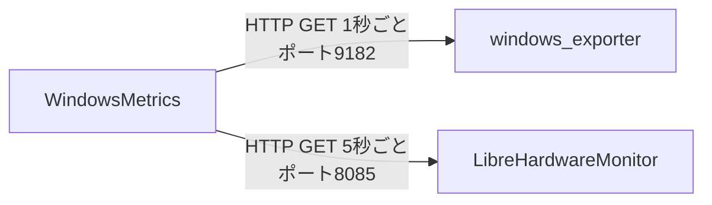

# WindowsMetrics

Windows 11 向けの軽量なシステムモニターウィジェット（WPF / .NET 10）。CPU・メモリ・GPU・ディスク・ネットワーク・温度センサーをデスクトップ上に常時表示する。

> English version: [README.md](README.md)

## 目次

1. [概要](#概要)
2. [動作要件](#動作要件)
3. [依存ソフトの導入](#依存ソフトの導入)
4. [WindowsMetrics の導入](#windowsmetrics-の導入)
5. [動作確認](#動作確認)
6. [設定](#設定)
7. [セキュリティ上の注意](#セキュリティ上の注意)
8. [トラブルシューティング](#トラブルシューティング)
9. [ライセンス](#ライセンス)

## 概要

WindowsMetrics が依存するのは、ローカルで動く 2 つのソフトウェアだけ。ループバックアドレス以外のネットワークには一切通信しない。

| ソフトウェア | 接続先 | 取得するもの | 既定周期 |
| --- | --- | --- | --- |
| [windows_exporter](https://github.com/prometheus-community/windows_exporter) | `http://127.0.0.1:9182/metrics` | CPU 使用率・C ステート、メモリ、GPU 使用率、ディスク I/O、ネットワーク、プロセス Top5、ACPI 熱ゾーン（下記のフォールバック用途のみ） | 1 秒 |
| **[LibreHardwareMonitor](https://github.com/LibreHardwareMonitor/LibreHardwareMonitor)**（必須） | `http://127.0.0.1:8085/metrics` | CPU パッケージ/コア・GPU・マザーボード・DIMM・ストレージの各温度 | 5 秒 |

**LibreHardwareMonitor がなければ、CPU・GPU・マザーボード・メモリー・ストレージのいずれの温度も表示できない。** また LibreHardwareMonitor 自体はハードウェアセンサーを読むために**管理者権限での実行が必須**。LibreHardwareMonitor がないと、CPU カードはマシンの ACPI 熱ゾーン（実際の CPU 温度ではなく、機種によっては値が変化しない粗い代替値）にフォールバックする。



WindowsMetrics 自身は待ち受けポートを一切開かない。2 つのローカルサービスへ発信するだけ。

## 動作要件

| 項目 | 要件 |
| --- | --- |
| OS | Windows 10（21H2 以降）または Windows 11、あるいは Windows Server 2016 以降（windows_exporter 側に Server 2012 R2 以前との既知の互換性問題あり） |
| .NET | Releases の zip は自己完結型（.NET 10 ランタイム同梱）で追加インストール不要。ソースからビルドする場合は [.NET 10 SDK](https://dotnet.microsoft.com/download) が必要 |
| 権限 | WindowsMetrics 本体は標準ユーザーで動作する。**LibreHardwareMonitor は管理者権限が必須。** windows_exporter は SYSTEM 権限の Windows サービスとして動作する |

## 依存ソフトの導入

### 推奨: `winget configure`

リポジトリには [WinGet 構成ファイル](https://learn.microsoft.com/ja-jp/windows/package-manager/configuration/) が同梱されており、2 つの依存ソフトの導入と WindowsMetrics が必要とする設定を 1 回（UAC プロンプト 1 回）で適用できる。

```powershell
winget configure validate -f .config/configuration.winget
winget configure test     -f .config/configuration.winget
winget configure          -f .config/configuration.winget --accept-configuration-agreements
```

これにより、windows_exporter が Windows サービスとして導入され（コレクタ: `cpu,memory,system,logical_disk,net,process,gpu,thermalzone`、`127.0.0.1:9182` のみで待ち受け、ファイアウォール例外なし）、LibreHardwareMonitor が winget で導入され、リモート Web サーバーがポート 8085 で有効化され、管理者権限でログオン時に起動するタスクが登録され、ポート 8085 へのインバウンド接続がブロックされる（LibreHardwareMonitor はループバック限定にできないため、ファイアウォールで代替する）。初回実行時は必要な DSC モジュール（`Microsoft.WinGet.DSC`、`PSDscResources`）が PowerShell Gallery から自動取得される。

`winget configure` の再実行は安全（すでに望む状態の項目には手を加えない）。

**windows_exporter の更新について**: `winget upgrade` はサービス稼働中の実行ファイルを差し替えられない。`Stop-Service windows_exporter` でサービスを停止してから更新し、`Start-Service windows_exporter` で再開すること。

### 手動での導入

`winget configure` が使えない環境では、同じ結果に手動で到達できる。

1. **windows_exporter**: `winget install --id Prometheus.WindowsExporter --exact --scope machine`（または [Releases](https://github.com/prometheus-community/windows_exporter/releases) から MSI を入手）。`%ProgramData%\windows_exporter\config.yaml` を作成する。

   ```yaml
   collectors:
     enabled: cpu,memory,system,logical_disk,net,process,gpu,thermalzone
   web:
     listen-address: 127.0.0.1:9182
   log:
     level: warn
   ```

   続けてサービスとして登録・起動する（管理者権限の PowerShell）。

   ```powershell
   $exe = "$env:ProgramFiles\WinGet\Links\windows_exporter.exe"
   New-Service -Name windows_exporter -BinaryPathName "`"$exe`" --config.file=`"$env:ProgramData\windows_exporter\config.yaml`"" -DisplayName "windows_exporter" -StartupType Automatic
   Start-Service windows_exporter
   ```

2. **LibreHardwareMonitor**: `winget install --id LibreHardwareMonitor.LibreHardwareMonitor --exact`。**管理者権限で**起動し、`Options` → `Remote Web Server` の `Port` を `8085` にして `Run` にチェックを入れる。

3. **ログオン時に管理者権限で自動起動**（管理者権限の PowerShell）。

   ```powershell
   $Action    = New-ScheduledTaskAction -Execute "C:\path\to\LibreHardwareMonitor.exe"
   $Trigger   = New-ScheduledTaskTrigger -AtLogOn
   $Principal = New-ScheduledTaskPrincipal -UserId "$env:USERDOMAIN\$env:USERNAME" -LogonType Interactive -RunLevel Highest
   Register-ScheduledTask -TaskName "LibreHardwareMonitor" -Action $Action -Trigger $Trigger -Principal $Principal
   ```

4. **LibreHardwareMonitor の Web サーバーをネットワークから遮断**（管理者権限の PowerShell。バインドアドレスをループバック限定にできないため）。

   ```powershell
   New-NetFirewallRule -DisplayName "Block LibreHardwareMonitor Web Server" -Direction Inbound -Action Block -Protocol TCP -LocalPort 8085
   ```

## WindowsMetrics の導入

### 方法 A: リリース版をダウンロード（推奨）

1. [Releases](../../releases) ページから `WindowsMetrics-vX.Y.Z-win-x64.zip` をダウンロードする。
2. 任意の場所に展開し `WindowsMetrics.exe` を実行する。自己完結型のため .NET ランタイムの追加インストールは不要。
3. 実行ファイルはコード署名されていないため、初回実行時に Windows SmartScreen が「認識されないアプリ」と警告することがある。**詳細情報** → **実行** を選ぶ。署名証明書を持たないオープンソースの未署名バイナリでは想定内の挙動。

### 方法 B: ソースからビルド

```powershell
git clone git@github.com:siosig/WindowsMetrics.git
cd WindowsMetrics
dotnet build WindowsMetrics.slnx -c Release
# Releases のダウンロードと同じ、自己完結の単一 WindowsMetrics.exe を作る場合:
dotnet publish WindowsMetrics/WindowsMetrics.csproj -c Release -o publish/win-x64
```

`dotnet publish` を実行すると `publish/win-x64` に単一の `WindowsMetrics.exe` が生成される。個別の DLL やランタイムファイルは含まれず、`-r`・`--self-contained` の指定も不要（プロジェクト側で win-x64・自己完結が publish 時の既定になっている）。

## 動作確認

WindowsMetrics を起動する前に、両エンドポイントが期待どおり応答するか確かめる。

**windows_exporter — 既定無効のコレクタが効いているか**

```powershell
$lines = (Invoke-WebRequest -Uri "http://127.0.0.1:9182/metrics" -UseBasicParsing).Content -split "`n"
$lines | Select-String "^windows_thermalzone_temperature_celsius"   # CPU 温度のフォールバック
$lines | Select-String "^windows_process_working_set_bytes"          # プロセス一覧
$lines | Select-String "^windows_gpu_engine_time_seconds"            # GPU 使用率
```

3 つとも 1 行以上返れば `process` / `gpu` / `thermalzone` が有効。空なら `ENABLED_COLLECTORS`（または `config.yaml` の `collectors.enabled`）の指定漏れ。

`thermalzone` だけ空の場合、マシンが ACPI サーマルゾーンを公開していない可能性がある。これが影響するのは、LibreHardwareMonitor が使えないときの CPU 温度フォールバックだけ（後述）。

**LibreHardwareMonitor — 各温度センサーが取れるか**

```powershell
$lhm = (Invoke-WebRequest -Uri "http://127.0.0.1:8085/metrics" -UseBasicParsing).Content -split "`n"
$lhm | Select-String "^lhm_cpu_temperature_celsius"                    # CPU（パッケージ/コア別）
$lhm | Select-String "^lhm_gpu\w+_temperature_celsius"                 # GPU
$lhm | Select-String "^lhm_motherboard_temperature_celsius"            # マザーボード（Mother 行）
$lhm | Select-String "^lhm_memory_temperature_celsius"                 # DIMM（m: Memory 行）
```

いずれも 1 行以上返るはず。何も返らないコマンドがある場合、該当カードの温度（および CPU・GPU・Mother の min/max/avg 行）は「--」になる。多くは LibreHardwareMonitor が管理者権限で起動していないため（ハードウェアセンサーを読むには昇格が必須）だが、そのセンサー自体をハードウェアが公開していない場合もある（一部のマザーボードは Mother 行の全項目を報告しない、等。[トラブルシューティング](#トラブルシューティング)を参照）。

## 設定

設定はレジストリ `HKEY_CURRENT_USER\Software\WindowsMetrics` に保存される。値が無ければ既定値で動く。

| 値名 | 型 | 既定 | 内容 |
| --- | --- | --- | --- |
| `WindowsExporterIntervalMs` | DWORD | `1000` | windows_exporter のポーリング間隔（ミリ秒、250〜60000 にクランプ） |
| `LhmIntervalMs` | DWORD | `5000` | LibreHardwareMonitor のポーリング間隔（同範囲） |
| `WindowsExporterUrl` | String | `http://127.0.0.1:9182/metrics` | windows_exporter の接続先 |
| `LhmUrl` | String | `http://127.0.0.1:8085/metrics` | LibreHardwareMonitor の接続先 |
| `FontFamilyName` | String | `Cascadia Mono` | 表示フォント |
| `FontSize` | String | `11` | フォントサイズ（8〜24 にクランプ） |
| `IsCalendarExpanded` | DWORD | `0` | カレンダーセクションの初期展開状態 |

値を変更したら WindowsMetrics を再起動して反映する。例: windows_exporter の周期を 1 秒から 2 秒に変え、比較的重い `process` コレクタを問い合わせから除外する。

```powershell
Set-ItemProperty -Path 'HKCU:\Software\WindowsMetrics' -Name 'WindowsExporterIntervalMs' -Value 2000 -Type DWord
Set-ItemProperty -Path 'HKCU:\Software\WindowsMetrics' -Name 'WindowsExporterUrl' `
  -Value 'http://127.0.0.1:9182/metrics?collect[]=cpu&collect[]=memory&collect[]=system&collect[]=logical_disk&collect[]=net&collect[]=gpu&collect[]=thermalzone' -Type String
```

（クエリ文字列から `process` を外すと、プロセス Top5 の表示は空になる。このデータは `process` コレクタからしか取れないため。）

## セキュリティ上の注意

どちらのエンドポイントにも認証がない。`process` コレクタを有効にすると、稼働中の全プロセス名と PID がポートに到達できる相手なら誰でも読める状態になる。

- windows_exporter は必ず `127.0.0.1` に限定する。ファイアウォール例外を作らないこと。
- LibreHardwareMonitor がバインドアドレスをループバックに限定できるかは未確認のため、上記のファイアウォール規則が実質的な防御になっている。維持すること。
- 別マシンから値を見たい場合は、ポートを直接公開せず SSH でトンネルすること。

## トラブルシューティング

| 症状 | 原因 | 対処 |
| --- | --- | --- |
| 何も表示されない | windows_exporter サービスが停止している | `Get-Service windows_exporter` で状態確認し、`Start-Service windows_exporter` で起動、スタートアップの種類を「自動」にする |
| 何も表示されない（サービスは稼働中） | ポート 9182 を他プロセスが使用中 | `netstat -ano \| Select-String ":9182"` で PID を特定。競合するならサービス側のポートを変更し `WindowsExporterUrl` も合わせる |
| CPU 温度が低い値で固定される | LibreHardwareMonitor が動いていない（または管理者権限で動いていない）ため、ACPI 熱ゾーンにフォールバックしている。機種によっては熱ゾーンの値が変化しない | LibreHardwareMonitor を**管理者として**起動する。[動作確認](#動作確認)の `lhm_cpu_temperature_celsius` で確認する |
| GPU 温度が「--」 | LibreHardwareMonitor の出力に "GPU Core" センサーが見つからない | `lhm_gpu*_temperature_celsius` が返るか確認する。内蔵 GPU や一部の古い GPU は温度センサーを公開しないことがある |
| Mother 行の一部が「--」 | マザーボードのセンサーチップが、WindowsMetrics が認識するセンサー名を使っていない | `lhm_motherboard_temperature_celsius` の `sensorName` を、プロジェクトの `contracts/hardware-temperature-metrics.md` にある別名一覧と突き合わせる。認識できない名前は推測せず「--」にする仕様 |
| DIMM・ストレージ温度が出ない | LibreHardwareMonitor が管理者権限で動いていない | タスクスケジューラの登録が「最上位の特権で実行する」になっているか確認。手動起動なら右クリック →「管理者として実行」 |
| プロセス Top5・GPU 使用率が空 | windows_exporter の `process` / `gpu` コレクタが無効 | `ENABLED_COLLECTORS`（または `config.yaml`）にすべて含めて再適用し、[動作確認](#動作確認)のコマンドで検証する |
| ストレージ温度がドライブレターに紐付かない | WMI のディスクモデル名と LibreHardwareMonitor のハードウェア名が一致しない | `Get-CimInstance Win32_DiskDrive \| Select-Object Model` と LibreHardwareMonitor の表示名を突き合わせる。アプリ側のあいまい一致でも拾えない表記揺れがあり得る |
| スリープ復帰後に温度の更新が止まる | LibreHardwareMonitor がセンサーを見失う既知の挙動 | LibreHardwareMonitor を再起動する。頻発するならスリープ復帰イベントをトリガーに再起動するタスクを登録する |
| 見覚えのない依存先が LAN から見える | `LISTEN_ADDR` の指定漏れ、または LibreHardwareMonitor のファイアウォール規則が未適用 | windows_exporter をループバック指定で再導入する。`Block LibreHardwareMonitor Web Server` 規則が存在し有効か確認する |
| SmartScreen でダウンロード・起動がブロックされる | 実行ファイルが未署名 | 「詳細情報」→「実行」を選ぶか、自分でソースからビルドする |
| アプリ自身のログに手掛かりがない | 仕様どおり、接続状態の変化のみを記録している | `%LOCALAPPDATA%\WindowsMetrics\logs\windowsmetrics-*.log` の該当時刻付近の Warning・Information を確認する |

## ライセンス

[MIT](LICENSE) — Copyright (c) 2026 Daisuke ITO
