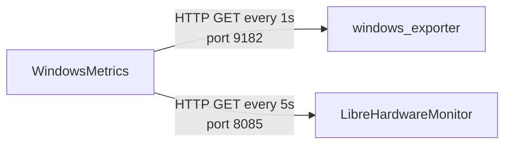

# WindowsMetrics

A lightweight, always-on-top-free system monitor widget for Windows 11 (WPF / .NET 10). It shows CPU, memory, GPU, disk, network, and temperature sensors right on your desktop.

> Japanese version: [README.ja.md](README.ja.md)

## Table of Contents

1. [Overview](#overview)
2. [Requirements](#requirements)
3. [Install the dependencies](#install-the-dependencies)
4. [Install WindowsMetrics](#install-windowsmetrics)
5. [Verify it's working](#verify-its-working)
6. [Configuration](#configuration)
7. [Security notes](#security-notes)
8. [Troubleshooting](#troubleshooting)
9. [License](#license)

## Overview

WindowsMetrics depends on exactly two other pieces of software, both running locally on your machine. It never talks to the network beyond your own loopback address.

| Software | Endpoint it polls | What it provides | Default interval |
| --- | --- | --- | --- |
| [windows_exporter](https://github.com/prometheus-community/windows_exporter) | `http://127.0.0.1:9182/metrics` | CPU usage/C-states, memory, GPU usage, disk I/O, network, top-5 processes, ACPI thermal zone (fallback only — see below) | 1 second |
| **[LibreHardwareMonitor](https://github.com/LibreHardwareMonitor/LibreHardwareMonitor)** (required) | `http://127.0.0.1:8085/metrics` | CPU package/core, GPU, motherboard, DIMM, and storage temperatures | 5 seconds |

**WindowsMetrics cannot show any temperature reading (CPU, GPU, motherboard, memory, or storage) without LibreHardwareMonitor, and LibreHardwareMonitor itself must run with administrator rights** to read hardware sensors at all. Without it, the CPU card falls back to your machine's ACPI thermal zone — a coarse, sometimes-constant value that is not the actual CPU temperature.



WindowsMetrics never opens a listening port of its own; it only makes outbound HTTP requests to these two local services.

## Requirements

| Item | Requirement |
| --- | --- |
| OS | Windows 10 (21H2+) or Windows 11, or Windows Server 2016+ (windows_exporter has known compatibility issues on Server 2012 R2 and earlier) |
| .NET | The Releases zip is self-contained (bundles its own .NET 10 runtime) — no separate install needed. Building from source requires the [.NET 10 SDK](https://dotnet.microsoft.com/download) |
| Privileges | WindowsMetrics itself runs as a standard user. **LibreHardwareMonitor requires administrator rights.** windows_exporter runs as a Windows service under SYSTEM |

## Install the dependencies

### Recommended: `winget configure`

The repository ships a [WinGet Configuration file](https://learn.microsoft.com/windows/package-manager/configuration/) that installs both dependencies and applies the settings WindowsMetrics needs in one step (one UAC prompt).

```powershell
winget configure validate -f .config/configuration.winget
winget configure test     -f .config/configuration.winget
winget configure          -f .config/configuration.winget --accept-configuration-agreements
```

This installs windows_exporter as a Windows service (collectors: `cpu,memory,system,logical_disk,net,process,gpu`, bound to `127.0.0.1:9182` only, no firewall exception), installs LibreHardwareMonitor via winget, enables its remote web server on port 8085, registers a logon task that starts it with administrator rights, and blocks inbound connections to port 8085 (LibreHardwareMonitor cannot be restricted to loopback only, so the firewall does that job instead). The first run downloads the required DSC modules (`Microsoft.WinGet.DSC`, `PSDscResources`) from the PowerShell Gallery.

Re-running `winget configure` is safe — it only changes what's not already in the desired state.

**Updating windows_exporter**: `winget upgrade` cannot replace the executable of a running service. Stop the service first: `Stop-Service windows_exporter`, run the upgrade, then `Start-Service windows_exporter`.

### Manual setup

If `winget configure` isn't available in your environment, the same end state can be reached by hand.

1. **windows_exporter**: `winget install --id Prometheus.WindowsExporter --exact --scope machine` (or download the MSI from [Releases](https://github.com/prometheus-community/windows_exporter/releases)). Write `%ProgramData%\windows_exporter\config.yaml`:

   ```yaml
   collectors:
     enabled: cpu,memory,system,logical_disk,net,process,gpu
   web:
     listen-address: 127.0.0.1:9182
   log:
     level: warn
   ```

   Then register and start it as a service (administrator PowerShell):

   ```powershell
   $exe = "$env:ProgramFiles\WinGet\Links\windows_exporter.exe"
   New-Service -Name windows_exporter -BinaryPathName "`"$exe`" --config.file=`"$env:ProgramData\windows_exporter\config.yaml`"" -DisplayName "windows_exporter" -StartupType Automatic
   Start-Service windows_exporter
   ```

2. **LibreHardwareMonitor**: `winget install --id LibreHardwareMonitor.LibreHardwareMonitor --exact`. Launch it **as Administrator**, then `Options` → `Remote Web Server` → set `Port` to `8085` and check `Run`.

3. **Auto-start LibreHardwareMonitor at logon with admin rights** (administrator PowerShell):

   ```powershell
   $Action    = New-ScheduledTaskAction -Execute "C:\path\to\LibreHardwareMonitor.exe"
   $Trigger   = New-ScheduledTaskTrigger -AtLogOn
   $Principal = New-ScheduledTaskPrincipal -UserId "$env:USERDOMAIN\$env:USERNAME" -LogonType Interactive -RunLevel Highest
   Register-ScheduledTask -TaskName "LibreHardwareMonitor" -Action $Action -Trigger $Trigger -Principal $Principal
   ```

4. **Block LibreHardwareMonitor's web server from the network** (administrator PowerShell; its bind address cannot be restricted to loopback):

   ```powershell
   New-NetFirewallRule -DisplayName "Block LibreHardwareMonitor Web Server" -Direction Inbound -Action Block -Protocol TCP -LocalPort 8085
   ```

## Install WindowsMetrics

### Option A: Download the release (recommended)

1. Download `WindowsMetrics-vX.Y.Z-win-x64.zip` from the [Releases](../../releases) page.
2. Extract it anywhere and run `WindowsMetrics.exe`. It's self-contained; no .NET runtime install is required.
3. Because the executable isn't code-signed, Windows SmartScreen may show an "unrecognized app" warning the first time you run it. Click **More info** → **Run anyway**. This is expected for an unsigned open-source binary — there's no code-signing certificate behind this project.

### Option B: Build from source

```powershell
git clone git@github.com:siosig/WindowsMetrics.git
cd WindowsMetrics
dotnet build WindowsMetrics.slnx -c Release
# or, to build a single self-contained WindowsMetrics.exe (same as the Release download):
dotnet publish WindowsMetrics/WindowsMetrics.csproj -c Release -o publish/win-x64
```

`dotnet publish` produces a single `WindowsMetrics.exe` in `publish/win-x64` — no separate DLLs or runtime files, no `-r`/`--self-contained` flags needed (the project targets `win-x64` and self-contained by default for publishing).

## Verify it's working

Before launching WindowsMetrics, confirm both endpoints respond as expected.

**windows_exporter — are the disabled-by-default collectors on?**

```powershell
$lines = (Invoke-WebRequest -Uri "http://127.0.0.1:9182/metrics" -UseBasicParsing).Content -split "`n"
$lines | Select-String "^windows_process_working_set_bytes"          # process list
$lines | Select-String "^windows_gpu_engine_time_seconds_total"            # GPU usage
```

If both return at least one line, `process` / `gpu` are enabled. Empty output means `ENABLED_COLLECTORS` (or `config.yaml`'s `collectors.enabled`) is missing one of them.

**LibreHardwareMonitor — are the temperature sensors reachable?**

```powershell
$lhm = (Invoke-WebRequest -Uri "http://127.0.0.1:8085/metrics" -UseBasicParsing).Content -split "`n"
$lhm | Select-String "^lhm_cpu_temperature_celsius"                    # CPU (package/per-core)
$lhm | Select-String "^lhm_gpu\w+_temperature_celsius"                 # GPU
$lhm | Select-String "^lhm_motherboard_temperature_celsius"            # motherboard (Mother row)
$lhm | Select-String "^lhm_memory_temperature_celsius"                 # DIMM (m: Memory row)
```

Each command should return at least one line. If a command returns nothing, that card's temperature (and, for CPU/GPU/Mother, its min/max/avg row) will show "--". This is most often because LibreHardwareMonitor isn't running as Administrator — it needs elevation to read hardware sensors at all — or because your hardware doesn't expose that particular sensor (e.g. some motherboards don't report every Mother-row item; see [Troubleshooting](#troubleshooting)).

## Configuration

Settings live in the registry at `HKEY_CURRENT_USER\Software\WindowsMetrics`. Missing values fall back to sensible defaults.

| Value name | Type | Default | Meaning |
| --- | --- | --- | --- |
| `WindowsExporterIntervalMs` | DWORD | `1000` | windows_exporter poll interval, in milliseconds (clamped to 250–60000) |
| `LhmIntervalMs` | DWORD | `5000` | LibreHardwareMonitor poll interval, in milliseconds (same range) |
| `WindowsExporterUrl` | String | `http://127.0.0.1:9182/metrics` | windows_exporter endpoint |
| `LhmUrl` | String | `http://127.0.0.1:8085/metrics` | LibreHardwareMonitor endpoint |
| `FontFamilyName` | String | `Cascadia Mono` | Display font |
| `FontSize` | String | `11` | Font size (clamped to 8–24) |
| `IsCalendarExpanded` | DWORD | `0` | Whether the calendar section starts expanded |

Restart WindowsMetrics after changing any value for it to take effect. Example: poll windows_exporter every 2 seconds instead of 1, and exclude the (comparatively expensive) `process` collector by querying it directly:

```powershell
Set-ItemProperty -Path 'HKCU:\Software\WindowsMetrics' -Name 'WindowsExporterIntervalMs' -Value 2000 -Type DWord
Set-ItemProperty -Path 'HKCU:\Software\WindowsMetrics' -Name 'WindowsExporterUrl' `
  -Value 'http://127.0.0.1:9182/metrics?collect[]=cpu&collect[]=memory&collect[]=system&collect[]=logical_disk&collect[]=net&collect[]=gpu' -Type String
```

(Dropping `process` from that query string means the process Top-5 sections go blank, since that data comes only from the `process` collector.)

## Security notes

Neither endpoint requires authentication. With the `process` collector enabled, every running process name and PID is readable over plain HTTP to whoever can reach the port.

- windows_exporter must always be bound to `127.0.0.1` — never add a firewall exception for it.
- LibreHardwareMonitor's bind address restriction is unconfirmed, so the firewall rule from the setup steps above is what actually keeps it off the network — keep it in place.
- If you need to view these values from another machine, tunnel over SSH rather than exposing the ports directly.

## Troubleshooting

| Symptom | Cause | Fix |
| --- | --- | --- |
| Nothing is displayed | windows_exporter service is stopped | `Get-Service windows_exporter`, then `Start-Service windows_exporter` and set Startup type to Automatic |
| Nothing is displayed, service is running | Port 9182 is taken by another process | `netstat -ano \| Select-String ":9182"` to find the PID; if it conflicts, change the service's port and update `WindowsExporterUrl` to match |
| CPU temperature is stuck at a low, constant value | LibreHardwareMonitor isn't running (or isn't running as Administrator), so the app has fallen back to the ACPI thermal zone, which on some machines never changes | Start LibreHardwareMonitor **as Administrator**; check with `lhm_cpu_temperature_celsius` in [Verify it's working](#verify-its-working) |
| GPU temperature shows "--" | No "GPU Core" sensor was found in LibreHardwareMonitor's output for your GPU | Confirm `lhm_gpu*_temperature_celsius` returns data; integrated/older GPUs may not expose a temperature sensor to LibreHardwareMonitor at all |
| Some Mother-row items show "--" | Your motherboard's sensor chip doesn't use the sensor names WindowsMetrics recognizes for that item | Compare `lhm_motherboard_temperature_celsius` output's `sensorName` values against the alias list in the project's `contracts/hardware-temperature-metrics.md`; unrecognized names are shown as "--" rather than guessed |
| DIMM / storage temperatures missing | LibreHardwareMonitor isn't running with administrator rights | Check the scheduled task runs with "Run with highest privileges"; if launched manually, right-click → "Run as administrator" |
| Process Top-5 or GPU usage are empty | `process` / `gpu` collectors disabled in windows_exporter | Re-apply with all collectors listed in `ENABLED_COLLECTORS` / `config.yaml`; check with the [verification](#verify-its-working) commands above |
| Storage temperature doesn't map to the right drive letter | WMI's disk model name and LibreHardwareMonitor's hardware name don't match | Compare `Get-CimInstance Win32_DiskDrive \| Select-Object Model` against LibreHardwareMonitor's display name; the app's fuzzy-match fallback may still miss unusual naming |
| Temperatures stop updating after sleep | Known LibreHardwareMonitor behavior: it can lose track of sensors across sleep/resume | Restart LibreHardwareMonitor; if this happens consistently, register a scheduled task that restarts it on the resume-from-sleep event |
| A dependency I don't recognize is visible on my LAN | Missing `LISTEN_ADDR`, or the LibreHardwareMonitor firewall block wasn't applied | Reinstall windows_exporter with the loopback address; confirm the `Block LibreHardwareMonitor Web Server` firewall rule exists and is enabled |
| SmartScreen blocked the download/launch | The executable isn't code-signed | Click "More info" → "Run anyway", or build from source yourself |
| Nothing useful in the app's own log | N/A — by design, only connection state changes are logged | Check `%LOCALAPPDATA%\WindowsMetrics\logs\windowsmetrics-*.log` for Warning/Information entries around the time of the problem |

## License

[MIT](LICENSE) — Copyright (c) 2026 Daisuke ITO
